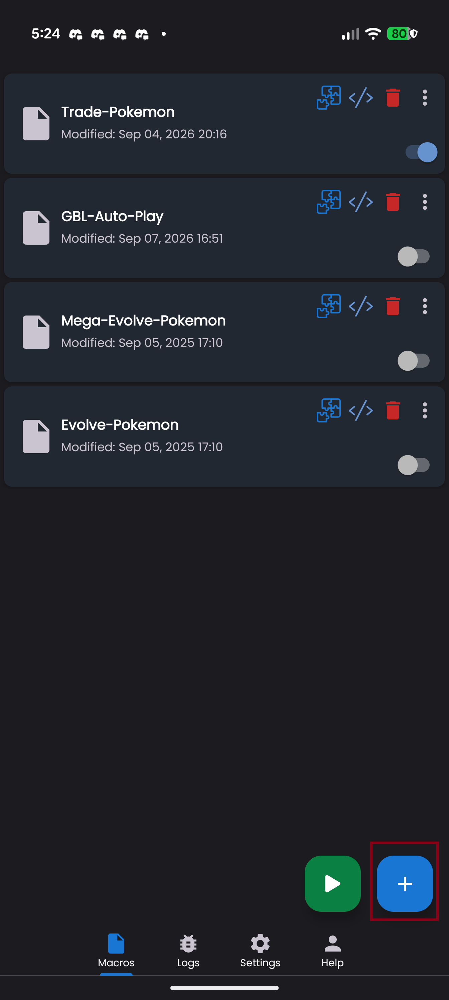
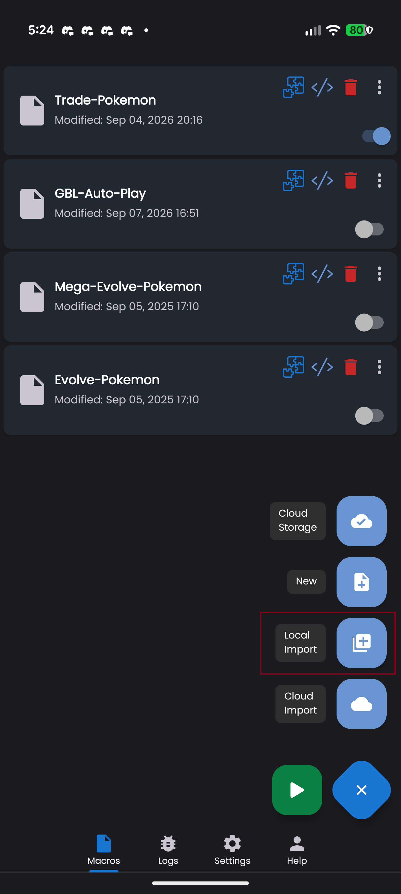
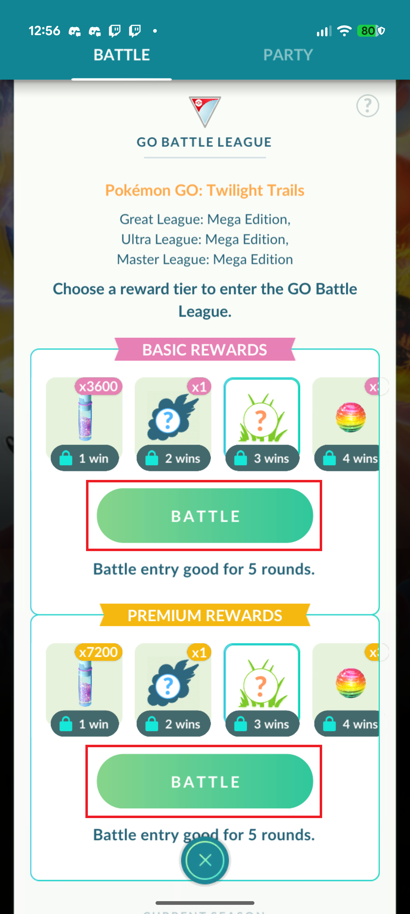
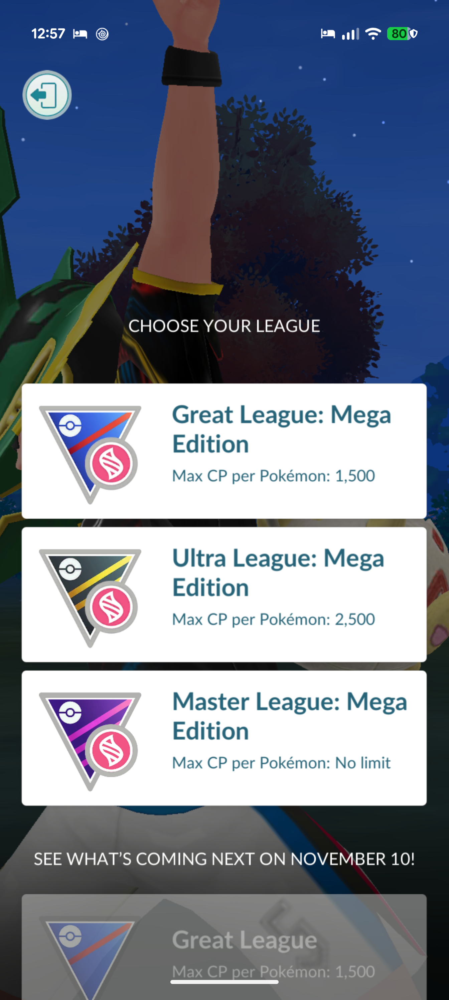
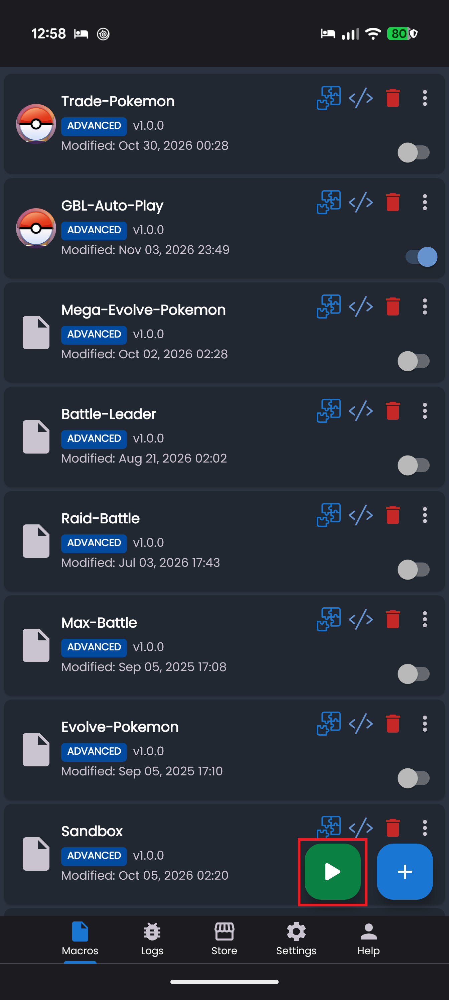
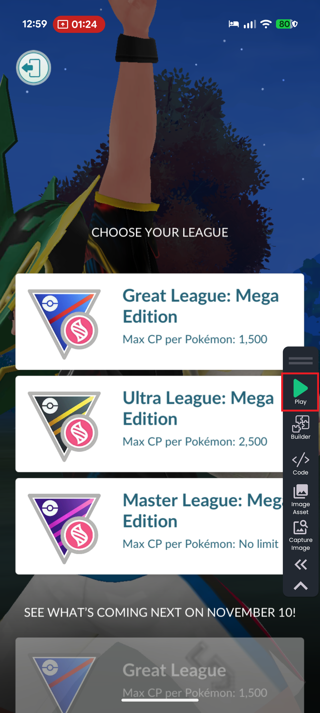
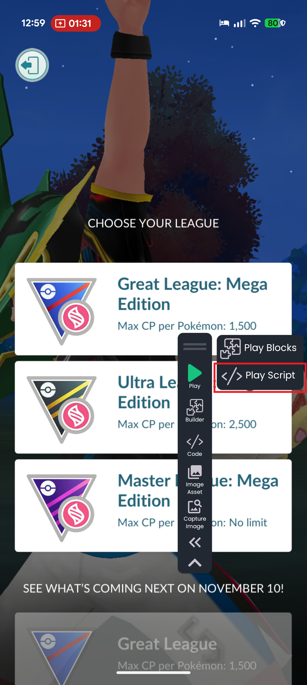
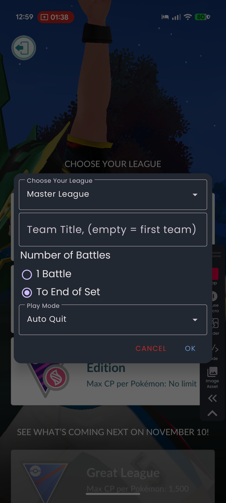

# Auto GBL Setup for the Android Macro

> [!WARNING]
> This is a beta release. The macro is functional, but it is still being tested and may need changes as more devices and edge cases are validated.

This macro automates the setup and completion of Pokémon GO GO Battle League matches. It can select a league or cup, choose a saved battle party, wait for matchmaking, and either let you play, auto-tap, or quit the battle. It does not play the battle intelligently.

## Contents

- [Auto GBL Setup for the Android Macro](#auto-gbl-setup-for-the-android-macro)
	- [Contents](#contents)
	- [What you need](#what-you-need)
	- [Compatibility](#compatibility)
	- [Why this is a beta release](#why-this-is-a-beta-release)
	- [Installing/updating the macro](#installingupdating-the-macro)
	- [In-game setup](#in-game-setup)
	- [Macro settings](#macro-settings)
		- [Play mode details](#play-mode-details)
	- [What the macro handles automatically](#what-the-macro-handles-automatically)
	- [Important limitations](#important-limitations)
	- [Other questions](#other-questions)
		- [Can I play manually while using the macro?](#can-i-play-manually-while-using-the-macro)
		- [Why did the macro stop immediately?](#why-did-the-macro-stop-immediately)
		- [Why was the wrong team selected?](#why-was-the-wrong-team-selected)
		- [Can this run on tablets or foldable phones?](#can-this-run-on-tablets-or-foldable-phones)
		- [Where do I report a problem?](#where-do-i-report-a-problem)
	- [Example](#example)

## What you need

| Requirement | Details |
| --- | --- |
| [Android Macro](https://androidmacro.com/) | Installed and working |
| Android Macro Pro | Purchased |
| Pokémon GO | Installed and logged in |
| Battle League access | Trainer Level 10+ |

## Compatibility

| Component | Supported versions/devices |
| --- | --- |
| Pokémon GO | 0.420.0+ |
| Android Macro | 1.0.0.36+ |
| Android version | Android 15+ |
| Phone type | Slab phones (non-foldable), including Samsung Galaxy S-series/A-series and Pixel phones |

Other phones may be compatible if they have a similar form factor. Android 14 and older may need additional tweaks; instructions will be added in the future.

## Why this is a beta release

This release is still in beta because the macro is being validated across a limited set of devices. League rotations and special cups change over time, so the script must be re-checked regularly to make sure it still matches the current league and cup selection process. The macro also needs additional testing on more phones to confirm it behaves consistently across different Android setups. Recovery logic is still being improved as more edge cases are uncovered, including the lack of proper termination handling when matchmaking fails.

## Installing/updating the macro

> [!TIP]
> Importing a newer file replaces the existing version of the macro.

1. [Download](https://github.com/MeGotsThis/android-macro-pokemon-go/releases) the macro.
2. Open Android Macro.

   
3. Click the + button on the bottom right.

   
4. Select **Local Import**.
5. Select the file.

## In-game setup

Before starting the macro, prepare your game like this:

1. Open Pokémon GO.
2. Go to Battle menu.
3. Select **Battle** and advance to the league selection screen.

   

   
4. Load the macro by pressing the green play button.
   - To switch macros, press the toggle button on the right side of the macro.

   
5. Run the macro with **Play Script**.
   - This must be done from the league selection

   

   
6. Fill in the settings. This only needs to be done once unless you want to change them. The macro remembers the settings for future runs.

   

## Macro settings

When the macro starts, it opens a small dialog with these settings:

| Setting | What it does |
| --- | --- |
| **Choose Your League** | Lets you select the current league row, a direct league, or a custom cup. |
| **Custom League Name** | Searches for a custom cup name when using **Custom League/Cup**. |
| **Team Title** | Selects the saved battle party to use. Leave empty to use the first available party. |
| **Number of Battles** | Sets whether the macro runs one battle or continues until the set ends. |
| **Play Mode** | Controls whether the macro waits, auto-quits, auto-taps, or taps for a fixed amount of time before quitting. |

### Play mode details

| Mode | Behavior |
| --- | --- |
| **Idle/Manual Play** | Does not tap automatically; lets you play manually. |
| **Auto Quit** | Surrenders at the first valid surrender opportunity. |
| **Auto Tap** | Taps the center of the battle screen until the battle completes. |
| **Tap 30 seconds & Quit** | Taps for 30 seconds, then surrenders. |
| **Tap 60 seconds & Quit** | Taps for 60 seconds, then surrenders. |

## What the macro handles automatically

This script includes logic for common GBL states, including:

- selecting an available league or cup
- selecting a saved battle party
- waiting for matchmaking and the battle to load
- manual, auto-tap, and auto-quit play modes
- surrender confirmation when quitting
- moving to the next battle in the set
- closing the final battle summary
- stopping when the set ends or an unexpected screen is detected

## Important limitations

- This is not a competitive battle bot. **Auto Tap** only taps the center of the battle screen; it does not use shields, swaps, or charged attacks intelligently.
- The macro does not automatically recover from every matchmaking error or unexpected dialog.
- Start the macro from the league selection screen.

## Other questions

### Can I play manually while using the macro?

Yes. Select **Idle/Manual Play**. The macro waits for the battle and then monitors it until it is complete.

### Why did the macro stop immediately?

The macro may have been started from a screen other than the league selection screen, or the selected league may not be available. Return to the league selection screen and try again.

### Why was the wrong team selected?

Enter the saved party name in **Team Title**. The party name matches any part of the input, and that team is used. For example, if the input is "Test" and the team name is "Running Test", it counts as a match. If the field is empty, the macro uses the first available party.

### Can this run on tablets or foldable phones?

The macro is designed for slab phones. Tablets and foldable phones may scale the Pokémon GO interface differently and are not currently guaranteed to work.

### Where do I report a problem?

Submit an issue [here](https://github.com/MeGotsThis/android-macro-pokemon-go/issues/new). Include your phone model, Android version, Pokémon GO version, selected settings, and screenshots of the screen where the macro stopped.

## Example

**Auto quit - 4 battles**

